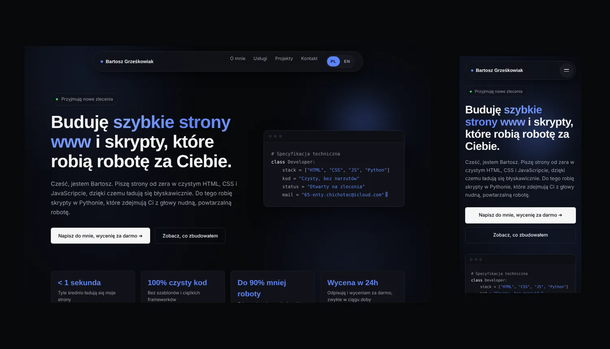

# Bartosz Grześkowiak

**Frontend Developer i specjalista od automatyzacji**

Szybkie strony www w czystym kodzie oraz skrypty w Pythonie, które robią nudną robotę za Ciebie.

 

  
  
  
  

  <a href="https://kukkenn.github.io"><b> Otwórz portfolio ➔</b></a>

 

---

##  &nbsp;O tym repozytorium

To kod mojego osobistego portfolio. Znajdziesz tu wszystko, czym się zajmuję, projekty, które zbudowałem, i sposób, żeby się ze mną skontaktować. Strona działa po polsku i po angielsku (język wybierasz na starcie) i jest projektowana najpierw pod telefon.

---

##  &nbsp;W czym pomagam

| | |
| :--- | :--- |
| **Strony i landing page** | Piszę od zera w czystym kodzie. Ładują się poniżej sekundy. |
| **Naprawa wyglądu i wersji mobilnej** | Znajduję błąd i sprawiam, że wszystko działa na każdym ekranie. |
| **Skrypty w Pythonie** | Automatyzuję powtarzalne zadania, np. porządkowanie plików CSV i Excela. |

---

##  &nbsp;Wybrany projekt

**[ProjectHub](https://github.com/Kukkenn/ProjectHub)** to lokalny menedżer projektów z komendami uruchamianymi jednym kliknięciem, skanerem katalogów i bezpiecznym podglądem stron. Wszystko działa na Twoim komputerze, więc kod i dane nigdzie nie wychodzą.

  
  
  

---

##  &nbsp;Kontakt

Masz pomysł albo problem do rozwiązania? Wycenię go za darmo, zwykle w ciągu doby.

  
  

---

##  &nbsp;Licencja

**Wszelkie prawa zastrzeżone.** Kodu, tekstów i grafik z tego repozytorium nie wolno kopiować, modyfikować, publikować ani używać we własnych projektach bez mojej pisemnej zgody. Szczegóły w pliku [LICENSE](LICENSE).

© 2026 Bartosz Grześkowiak

